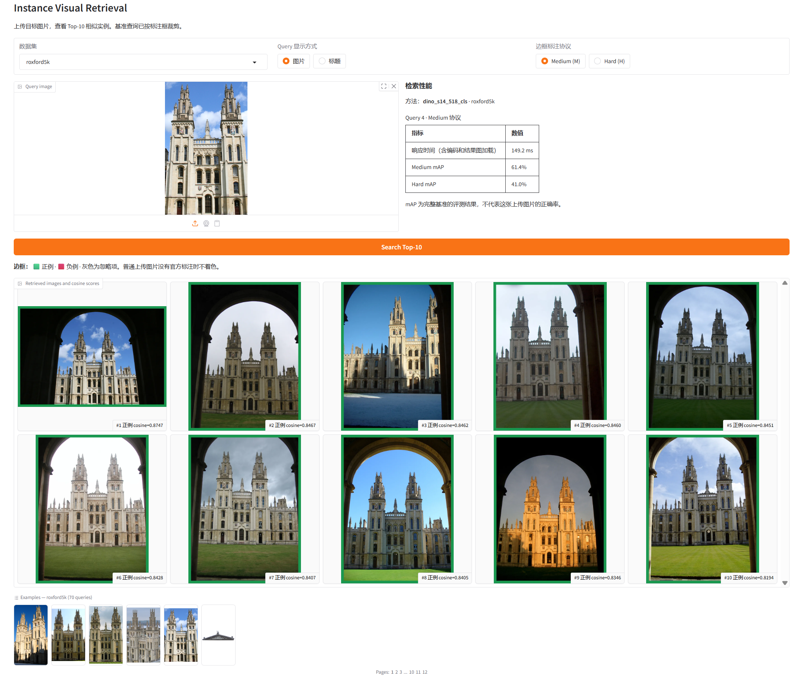

# Instance Visual Retrieval

This is the coursework of Digital Media Theory and Technology, we do instance-level image retrieval on ROxford5k and RParis6k. Implement the algorithms in `instance_retrieval/` and use `writeup.ipynb` for experiments and analysis.

## Setup

Clone this repo run:

```bash
git clone https://github.com/congyuxiaoyoudao/instance-visual-retrieval.git
cd instance-visual-retrieval
```

Then create a virtual environment, install requirements and register as an ipynb kernel:

```bash
python -m venv .venv
source .venv/bin/activate
python -m pip install -e .
python -m ipykernel install --user --name ivr --display-name "Instance Retrieval"
```
Open `writeup.ipynb` and select the **Instance Retrieval** kernel.

## Implementation

Complete the 10 `TODO(Px)` functions.

| Problem | Module | Functions |
|---|---|---|
| P1: Evaluation protocols | `evaluation.py` | `protocol_ground_truth` |
| P2: Cosine retrieval | `search.py` | `cosine_search` |
| P3: CLS / GeM pooling | `deep.py` | `pool_dino_tokens` |
| P4: Local features and vocabulary | `local.py` | `extract_sift`, `rootsift`, `sample_descriptors`, `train_vocabulary` |
| P5: VLAD encoding | `local.py` | `encode_vlad` |
| P6: Geometric reranking | `geometry.py` | `geometric_inliers`, `rerank` |

Data loading, query cropping, model inference, caching, plotting, and the official `compute_map` are provided. **DO NOT CHANGE the official AP/mAP implementation.

## Tests

Use the following scripts to test your implementation.

```bash
python -m pytest -q -m infrastructure  # Provided components
python -m pytest -q -m coursework     # Student implementations
python -m pytest -q                   # All tests
```

Unfinished exercises raise `NotImplementedError`.

## Experiments

Complete the tests before running full experiments. Answer the six written questions in `writeup.ipynb`.

- **Deep features:** DINOv2 ViT-S/14 and CLIP ViT-B/32. Compare DINOv2 at 224/518 resolution with CLS/GeM pooling. Compare against the paper baseline and investigate gaps above five percentage points.
- **Local features:** RootSIFT, VLAD K=64/256, and Top-N RANSAC. Keep at most 1,000 keypoints per image, store descriptors as uint8, and train on about one million sampled database descriptors.
- **E1:** Report mAP, mP@10, dimensions, bytes per image, and query time on both datasets under Medium/Hard.
- **E2:** Compare both vocabulary sizes with and without RANSAC.
- **E3:** Analyze at least three failed queries with Top-10 comparisons and error-category counts for both model families.

```bash
bash run_all.sh   # Tests and full experiments
bash run_eval.sh  # Re-evaluate cached features
```

Results are stored to `results/coursework/`; features are stored to `cache/coursework/`.

## Demo

After generating features and results:

```bash
python -m instance_retrieval.cli demo --port 17861
```

Open http://127.0.0.1:17861 to visualize results.

